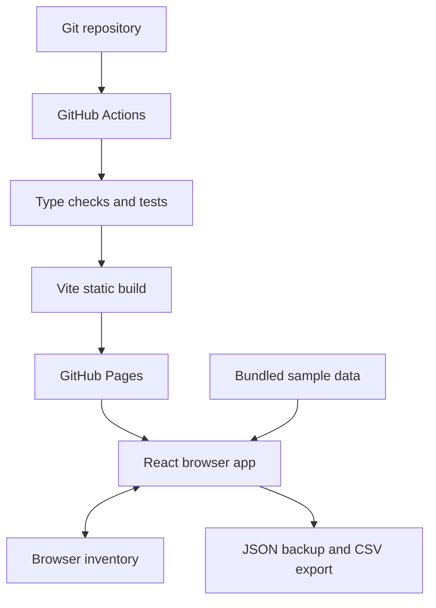
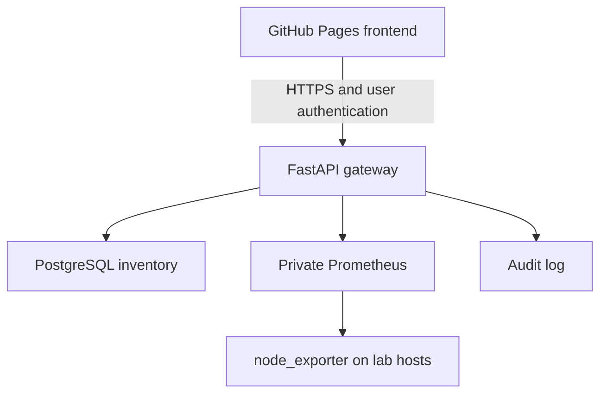

# Architecture

## Version 1: implemented

| Layer | Responsibility | Location |
| --- | --- | --- |
| React + TypeScript | UI, filters, forms, details and client-side navigation | Browser |
| Model module | Inventory validation, CSV conversion, derived alerts | Browser |
| localStorage | Versioned inventory envelope: `{version:1, servers:[...]}` | Current browser/origin |
| Sample dataset | Six fictional hosts with simulated metrics | Source bundle |
| Vite | Compile and bundle source to `dist/` | Local machine / Actions |
| GitHub Actions | Install locked packages, test, type-check, build, deploy | GitHub |
| GitHub Pages | HTTPS static asset hosting | GitHub |

State is kept in React. Inventory mutations are serialized into browser localStorage. Invalid stored data falls back to a labelled sample and emits a warning; it is not silently overwritten on initial load. JSON imports validate record shape, unique IDs, numerical bounds and count before a confirmed replacement. CSV exports escape fields and prefix formula-like values. No raw HTML is injected from inventory strings.

Metrics are demonstration values. Refresh varies CPU for active sample hosts, recomputes statuses and rebuilds synthetic chart curves. No historical time series is collected. Averages exclude offline and unmonitored hosts; uptime is supplied sample data. Sample refresh is transient unless an inventory save/export captures its current values. CPU/memory/disk thresholds are 80%. New servers have no metrics connection.

## Future Version 2: proposed, not implemented

Run the API on a lab gateway or suitable hosted service reachable by the client over HTTPS. Enforce authentication and per-user authorization server-side; permit only the required frontend origin in CORS. Keep Prometheus/exporter endpoints private. Model timestamps, stale data and partial failures explicitly. Separate inventory metadata from real time-series data and stop shipping any real inventory inside the public bundle.

Remote automation is a later phase: browser → authenticated API → AWX. Keep AWX credentials on the backend, enforce least-privilege job templates and approvals, and record audit logs. A static page cannot execute Bash, ping hosts or safely hold SSH/API secrets. GitHub Pages does not replace that backend.

## Scope boundaries

No authentication, cloud sync, polling agent, live SSH, package scanning, notification delivery or server reboot is implemented. Website access across devices works; inventory synchronization across devices does not. Public deployment exposes bundled sample information and code, while locally entered inventory is stored on that device only. Avoid sensitive corporate data on an unauthenticated personal tool.
